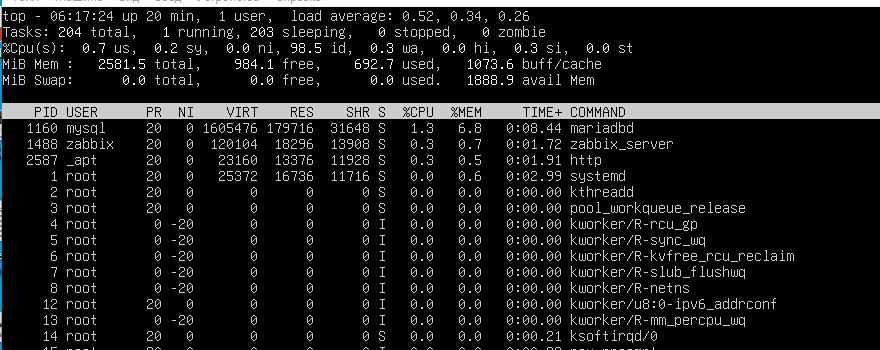

#Linux Process
Процесс можно понять на примере книги рецептов: рецепт - это программный код, написанный программистами, а процессом будет его выполнение. По идее все это будто бы всё, что нужно знать, но есть еще моменты: что такое демоны и зомби процессы? какие системные вызовы есть? как читать выводы команд top (htop) и ps?
##Демоны и зомби
Как я понял, демон - это процесс, который выполняется на фоне, не мешая что ли, а может и мешая, и обычно оканчивается на "d" (systemd, crond, sshd).
Зомби - это процесс, который уже вроде как сдох, но запись о нем еще хранится, и я так понял вместе с ней и PID. 
##Системные вызовы
Начнем с fork(), о котором я услышал уже 10 раз за час. Вроде как вызов форк вызывает дочерний процесс, дальше exec() выполнение этого дочернего процесса, после выполнение exit(). Если ошибка и процесс остался, то теперь он зомби. Родитель чтобы освободить PID должен дождаться окончания дочернего процесса, если у нас зоиби, то спасает вызов wait().
##Как читать выводы команд top htop и ps
Команда top выводит такую инфу:
load average, tasks, cpu%, mibmem, mibswap

###Одно из важных - Load average. В нашем случае видим 3 хар-ки - 0.52, 0.34, 0.26. Это 3 временных интервала: Первая - средняя нагрузка за 1 мин, вторая - за 5 мин, третья - за 15 мин. Как понять? Смотря сколько у нас ядер, допустим 4. Если хар-ка 1 - небольшая нагрузка, 2 - умеренная, 4 - процессорные ресурсы полностью заняты, 8 - очередь задач может расти. 
Но есть ньюанс: load average учитывает не только процессы, ожидающие CPU, но и процессы в непрерывном ожидании, например ожидании дискового ввода-вывода.
###CPU%(S) - это показатель исопльзования процессорного времени. Мы видим хар-ки с какими-то обозначениями по типу us, sy и т.д. us (user) - время CPU на выполнение пользовтельских процессов, system - задачи ядра, nice - задачи с измененным приоритетом, idle - время простоя процессора, wa - время ожидания операций ввода-вывода, hi - время обработки аппаратных прерываний, si - обработка программных прерываний, steal - время отнятое гипервизором у виртуальной машины.
###MiB Mem и Swap - оперативная память и область подкачки. 

В общем, теоретически понятно что такое процесс. Что касается их видов, то демона и зомиби разобрали, но вроде как есть еще и сироты, тип дочерние процессы у которых родительский умер раньше них.